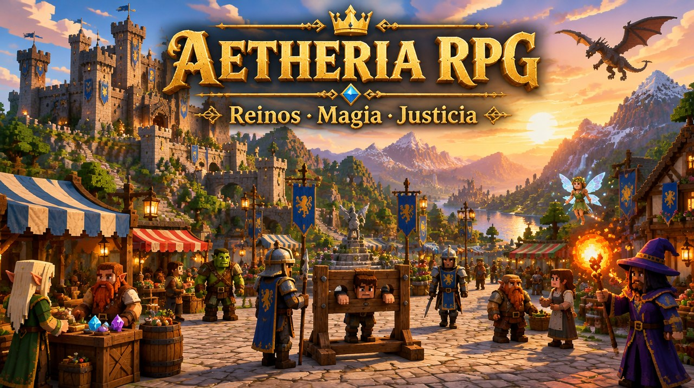

# Aetheria RPG — Add-on RPG completo para Minecraft Bedrock



Add-on (Behavior Pack + Resource Pack) que convierte Minecraft Bedrock en un RPG de fantasía: **naces como un niño o niña en una familia de NPCs**, creces hasta la edad adulta, tienes raza, magia y talento al azar, subes de rango de **F a SSS** en el Gremio de Aventureros, completas **misiones nuevas cada día**, hablas con los NPCs **escribiéndoles con texto libre** (y te responden y te envían cartas), y eliges si ser **héroe o villano**.

**Novedades de la versión 2:** un mundo vivo con **reinos, capitales, ciudades, pueblos y aldeas de 10 culturas**, guardias que patrullan, asaltos nocturnos, NPCs con **rutina diaria** (trabajan, comercian, van a la taberna, a misa y a dormir), **economía con regateo**, **clases sociales y hazañas**, **robos con minijuego de sigilo**, sistema de **SE BUSCA** con estrellas, **cepo público con tomates, cárcel y fugas**, **animación de nacimiento**, tamaños reales por edad (niño ≈ 1 bloque, joven algo más, adulto 2 bloques) y **hechizos rehechos** con proyectiles, efectos y partículas propias de cada elemento.

> Requisitos: **Minecraft Bedrock 1.26.10 o superior** (Script API `@minecraft/server` 2.6.0). Funciona en mundos de un jugador, LAN, Realms y servidores BDS. En multijugador, cada jugador tiene su propia historia, familia, progreso y relaciones.

---

## Instalación

1. Descarga **`dist/AetheriaRPG.mcaddon`** y ábrelo (doble clic) — Minecraft importará los dos paquetes.
   - O bien copia `packs/AetheriaRPG_BP` a `behavior_packs/` y `packs/AetheriaRPG_RP` a `resource_packs/`.
2. Crea un mundo nuevo (recomendado) y activa **Aetheria RPG** en *Paquetes de comportamiento* (el de recursos se añade solo).
3. Opcional: en *Experimentos*, activa **Biomas personalizados** si tu versión los marca como experimentales, para que aparezcan los 6 biomas nuevos. Todo lo demás funciona sin experimentos.
4. Entra al mundo: comenzará la ceremonia de nacimiento.

> ⚠ El add-on modifica `player.json` (para cambiar el tamaño del jugador según raza y edad). Puede ser incompatible con otros add-ons que también lo modifiquen.

---

## Lo que incluye

### Nacimiento, familia y crecimiento
- Al unirte por primera vez **naces** con una **animación de nacimiento** (cámara cinemática sobre la cuna, tus padres y la revelación de tu raza, tu elemento y tu don): eliges si eres niño o niña y se generan al azar tu **raza**, **elemento mágico**, **talento** y **una habilidad inicial**.
- Se construye la **casa familiar** junto al pueblo y aparecen tus **padres NPC** y, a veces, **hermanos** (0 a 3, mayores o menores). Tu punto de reaparición es tu casa.
- **Creces jugando**: niño/a → adolescente (40 %) → adulto/a al completar **1 mes de juego** (30 días por defecto, configurable). Tu tamaño aumenta progresivamente: de niño mides **~1 bloque**, de joven **algo más de 1 bloque** y de adulto **2 bloques** (ajustado por raza: enanos y hadas más bajos, orcos y dracónidos más altos).
- Los niños son más pequeños y débiles pero aprenden pasatiempos más rápido. Los adolescentes ya pueden inscribirse en el Gremio; los adultos pueden casarse.
- Tus padres te dan **paga diaria**, **encargos familiares**, consejos y te escriben **cartas**. Si un familiar muere, la sacerdotisa puede **resucitarlo**.

### Reinos, ciudades y pueblos vivos (v2)
- Al explorar se generan **aldeas, pueblos, ciudades y capitales** (cada ~350 bloques, las capitales cada ~900), agrupados en **reinos** con nombre, bandera, **soberano** (rey, reina, consejo o sumo sacerdote), **leyes** (indulgentes, firmes o implacables) y **economía** propia (agrícola, minera, comercial, mágica…).
- **10 culturas** con su propia arquitectura y gente: humanos, elfos, enanos, orcos, hombres bestia, demonios, celestiales, vampiros, hadas y dracónidos. Tejados, materiales, murallas, torres y castillos cambian según la cultura; cada reino ve con mejores o peores ojos a cada raza.
- Edificios: casas de clase **baja, media y alta** con muebles y cofres con dueño, **mercado, herrería, taberna, templo**, granjas, **plaza con picota (cepo)**, **cárcel con celdas**, cuartel, castillo con **sala del trono** en las capitales y **murallas con puertas** en ciudades y capitales.
- **Guardias** que patrullan rutas, persiguen a los buscados y defienden el pueblo; **asaltos nocturnos** de monstruos que puedes ayudar a rechazar (recompensa y hazaña).
- La primera vez que entras en un lugar aparece su nombre, el reino al que pertenece y quién gobierna. El Diario guarda un **atlas** de los lugares descubiertos.

### Vida diaria de los NPCs (v2)
- Cada habitante tiene **oficio, casa, horario y clase social**: de día trabaja (campo, forja, puesto del mercado…), a mediodía va a la plaza, por la tarde a la taberna o al templo, y de noche vuelve a casa a **dormir** (se les ve “Zzz”). Los guardias hacen rondas y relevos.
- Hablan entre ellos con **bocadillos** de texto, comentan el tiempo, los rumores del reino, tus hazañas… y reaccionan a ti según tu fama, tu clase y tu raza.
- **Economía**: cada pueblo tiene precios distintos según su reino, el día de mercado, tu fama y tu clase; los mercaderes tienen **bolsa propia** y pagan impuestos al reino. Puedes **regatear** (ofrece una cantidad y el mercader acepta, contraoferta o se ofende).
- **Trabajos por un día** (cosechar, forjar, servir en la taberna…) y **carteristas** NPC que intentan robarte a ti.

### Clases sociales y hazañas (v2)
- Tu **clase** (mendigo, plebeyo, ciudadano, burgués, caballero o noble) depende de tu origen familiar, tu oro, tu casa, tu rango en el Gremio, tu comercio y tus títulos; con mucha fama te conocerán además como **héroe** o **leyenda**, y con mucha infamia como **temido**. Puedes comprar un **título nobiliario**.
- Los NPCs **notan tu clase**: los nobles desprecian a los pobres, los pobres desconfían de los ricos, y todos tratan distinto a un héroe famoso que a un criminal infame.
- **Hazañas**: derrotar jefes, limpiar mazmorras, ascender en el Gremio o defender un pueblo te dan **fama** en ese reino; los crímenes y castigos te dan **infamia**. Las hazañas aparecen en el Diario y los NPCs hablan de ellas.

### Robos, SE BUSCA y justicia (v2)
- **Robar del bolsillo**: agáchate detrás de alguien y tócale → **minijuego** de aguja: suelta en la zona verde. Más fácil a sus espaldas, de noche o si duerme. También puedes **forzar cofres** dentro de las casas (con ganzúa).
- **Indicador de ojo** en el HUD: ojo **cerrado** = nadie te ve, ojo **entreabierto** = alguien te está mirando, ojo **abierto** = te han visto robar.
- El testigo grita, le aparece un **(!)** encima y **corre al guardia más cercano** → recibes **estrellas de SE BUSCA** (★). Los guardias salen a buscarte; también aparecen **carteles de Se Busca**. Las estrellas bajan con el tiempo si nadie te ve.
- Castigos:
  - **Delito menor** (1★): **humillación pública** de 1 minuto: te atan las manos, un guardia te lleva **de una cuerda al cuello** por la plaza y te dejan en el **cepo** mientras la gente se acerca a **tirarte tomates**.
  - **Delito grave** (2-3★): **15 minutos de cárcel**.
  - **Asesinato** (4-5★): **30 minutos de cárcel**.
- **Fuga**: a veces el **carcelero** pasa a vigilar; agáchate junto a los barrotes y róbale la **llave** para abrir tu celda. Si te pilla, **te atan las manos** hasta que termines la condena.
- Los nobles pueden pagar una **multa** en lugar del cepo, y los héroes muy famosos a veces reciben el perdón de la guardia.

### 10 razas, cada una con algo único
| Raza | Tamaño | Afinidades | Lo único |
|---|---|---|---|
| Humano | normal | equilibradas | +15 % XP, **segundo elemento** al nivel 40 |
| Elfo | normal | Naturaleza, Viento, Luz | visión nocturna, +30 % arco, **alquimia élfica** (el doble de elixires y recetas exclusivas) |
| **Enano** | **pequeño** | Tierra, Fuego | **+20 % daño**, prisa minera bajo tierra, **Forja Rúnica**: graba **runas únicas** en espadas, armaduras y herramientas, funde minerales **al doble** y forja armas enanas |
| Orco | grande | Fuego, Tierra, Sangre | +30 % daño, Furia, +25 % XP de combate |
| Hombre Bestia | normal | Naturaleza, Viento, Rayo | velocidad y salto, **escala un 60 % más rápido**, doble botín de caza |
| Demonio | normal | Oscuridad, Fuego, Sangre | inmune al fuego, pactos, misiones oscuras +50 % |
| Celestial | normal | Luz, Viento | planeo, curaciones ×1.5, castiga a no-muertos |
| Vampiro | normal | Sangre, Oscuridad, Necromancia | robo de vida, poder nocturno, débil al sol |
| Hada | diminuta | Naturaleza, Luz, Arcano | maná +50 %, caída lenta, hace crecer cultivos |
| Dracónido | grande | Fuego, Rayo | resistencia al fuego, escamas, aliento de dragón |

Cada raza tiene además una **habilidad racial** activa.

### Magia: 12 elementos × 50 habilidades = 600 hechizos
- Elementos: **Fuego, Agua, Tierra, Viento, Rayo, Hielo, Luz, Oscuridad, Necromancia, Naturaleza, Arcano y Sangre** (al azar al nacer, con probabilidad según tu raza).
- Cada elemento tiene un **árbol de 50 habilidades** en **10 ramas** (proyectil, explosión, potenciación, maldición, haz perforante, dominio, protección, movilidad, invocación y cataclismo) de **5 niveles**, cada una con nombre propio (p. ej. *Chispa → Bola de Fuego → Flecha Solar → Cometa Carmesí → Ira de Surtur*).
- **Rango mágico de F a SSS**: sube lanzando hechizos (multiplicado por tu talento). Los niveles altos del árbol exigen rango S, SS o SSS.
- Efectos por elemento: quemar, empapar, aturdir, empujar, cadena eléctrica, congelar, daño doble a no-muertos, ceguera, marchitar y robar vida, veneno, levitación, desangrar…
- Invocaciones aliadas (fuegos fatuos, lobos elementales, gólems, esqueletos…).

### Experiencia, niveles y pasatiempos
- Nivel 1-100. Cada nivel da **3 puntos de estadística** (Fuerza, Vitalidad, Agilidad, Inteligencia) y **puntos de habilidad**.
- XP por combate, misiones, mazmorras, jefes, exploración y **8 pasatiempos** con niveles y ventajas propias: Minería, Tala, Agricultura, Pesca, Caza, Herrería, Alquimia y Exploración.

### Gremio de Aventureros (rangos F → SSS)
- Sede construida automáticamente junto al inicio del mundo, con **recepcionista, maestro del gremio, mercader, herrero enano y sacerdotisa**.
- Inscripción (desde adolescente): los miembros ganan **×1.5 XP** en combate, misiones y mazmorras.
- **Tablón de misiones nuevo cada día**, misiones por rango, ascensos anunciados a todo el servidor, ranking, canje de núcleos de monstruo, tablón de recompensas por villanos.

### Misiones diarias
- Cada día del juego recibes **3 misiones diarias personales** (generadas para ti): cazar, minar, talar, cosechar, pescar, explorar, conversar, lanzar hechizos…
- **Encargos familiares** (llevar objetos a tu madre, padre, hermanos), **misiones del gremio** y **encargos oscuros**.

### Héroe o villano
- Tus actos cambian tu **karma** (−1000 a +1000): *Héroe Legendario, Héroe, Justo, Neutral, Sombrío, Villano, Señor Oscuro*.
- Héroes: descuentos, efecto *Héroe de la aldea*, magia de luz más fuerte.
- Villanos: acceso a la **Hermandad de la Sombra** (figura encapuchada que aparece de noche junto al Gremio), misiones oscuras, magia oscura más fuerte… pero el Gremio **suspende su licencia** y otros jugadores pueden **cobrar la recompensa por su cabeza**.

### NPCs con los que se habla escribiendo
- Toca a cualquier NPC → **Hablar (escribir)**: escribes lo que quieras y responde según su **rol, personalidad, humor del día, tu relación, tu karma y tu edad**. Detecta saludos, preguntas, cumplidos, insultos, coqueteo, disculpas, chistes, consejos, magia, gremio, monstruos, leyendas…
- **Memoria**: te hacen preguntas y recuerdan tus respuestas (comida favorita, sueños, mascota…) para mencionarlas después.
- **Relaciones** de *Enemigo* a *Inseparables*, regalos con gustos por rol y raza, citas y **matrimonio** (con anillo de compromiso; tu pareja se muda a tu casa).
- **Te escriben a ti**: saludos cuando pasas cerca y **cartas** en tu buzón que puedes responder desde el Diario.

### Mundo: biomas, monstruos, cuevas, mazmorras y jefes
- **6 biomas nuevos**: Bosque Encantado, Tierras Malditas, Picos Enanos, Desierto de Ceniza, Pantano Necrótico y Tundra Cristalina.
- **Minerales nuevos**: mitrilo, adamantita y cristales de maná (vetas en cuevas).
- **13 monstruos**: Goblin, Lobo Huargo, Orco Salvaje, Escorpión de las Dunas, Caballero Esqueleto, Araña Gigante, Espectro, Mímico, Mago Oscuro, Gólem de Escarcha, Diablillo de Fuego, Trol de las Cavernas y Caballero Demoníaco. Se vuelven más fuertes lejos del pueblo y con el paso de los días.
- **7 jefes** con barra de jefe y habilidades propias: Rey Goblin (D), Reina Araña (C), Gólem Ancestral (B), Liche Eterno (A), Azazel (S), Wyrm de Ceniza (SS) y El Rey del Vacío (SSS). Se invocan con **sellos**.
- **Mazmorras procedurales con rango F → SSS** que aparecen cerca de ti mientras exploras: pozo de entrada, oleadas de monstruos, jefe final y cofre de tesoro.
- **Regiones con nombre** que descubres al explorar.

### Escalada
- Mantén **SALTAR contra una pared** para trepar (gasta aguante) y **agáchate** para sujetarte. Los hombres bestia escalan mucho más rápido; los enanos, más lento.

---

## Controles y objetos

| Objeto | Uso |
|---|---|
| **Diario del Aventurero** | Usar: menú principal (perfil, estadísticas, magia, misiones, gremio, familia, relaciones, cartas, pasatiempos, raza, mazmorras, forja, alquimia, guía, opciones). |
| **Grimorio** / **Báculos** | Usar: lanzar el hechizo seleccionado. **Agacharse + usar**: cambiar de hechizo (hasta 6 ranuras). |
| **Licencia de Aventurero** | Muestra tu rango y puntos del gremio. |
| **Sellos de jefe** | Invocan al jefe correspondiente. |
| **Ganzúa** | Fuerza cofres ajenos (es un delito si te ven). |
| **Llave de la celda** | Robada al carcelero: úsala en la puerta de tu celda para fugarte. |
| **Cartel de Se Busca** | Muestra quién está buscado en el reino y por qué. |
| **Título nobiliario** | Te convierte en noble de un reino. |
| **Tomate** | Se come o se lanza (como hacen los aldeanos al que está en el cepo). |
| **Agacharse + tocar a un NPC** | Intentar robarle del bolsillo (minijuego). |
| Pociones de maná / elixires | Recuperan maná, vida o dan efectos. |

La **forja** se usa junto a un yunque, mesa de herrería o alto horno (o hablando con el herrero). La **alquimia** junto a un soporte para pociones, caldero o mesa de encantamientos (los elfos, en cualquier lugar).

La barra inferior (HUD) muestra vida, maná, nivel, rango, elemento, hechizo seleccionado, el rango/nivel del monstruo al que apuntas y, si estás robando o te buscan, el **ojo de sigilo** y las **estrellas de SE BUSCA** (o el tiempo de condena que te queda).

---

## Administración

Los operadores (o jugadores con la etiqueta `rpg_admin`) ven **Administración** en el Diario, con ajustes del mundo (días hasta la adultez, multiplicadores de XP, frecuencia de mazmorras, PvP mágico, escalada, cartas…). También hay comandos:

```
/scriptevent rpg:menu               abrir el Diario
/scriptevent rpg:reset              renacer (nuevo personaje)
/scriptevent rpg:xp 500             dar XP
/scriptevent rpg:gold 100           dar oro
/scriptevent rpg:karma -300         cambiar karma
/scriptevent rpg:adult              crecer hasta adulto
/scriptevent rpg:age 5              sumar días de edad
/scriptevent rpg:race enano         cambiar raza (humano, elfo, enano, orco, bestia, demonio, celestial, vampiro, hada, draconido)
/scriptevent rpg:element fuego      cambiar elemento
/scriptevent rpg:guild 4            fijar rango del gremio (0=F … 8=SSS)
/scriptevent rpg:magic 6            fijar rango mágico
/scriptevent rpg:dungeon 2          crear una mazmorra de rango D cerca
/scriptevent rpg:boss lich          invocar un jefe
/scriptevent rpg:set daysToAdult 8  cambiar un ajuste (p. ej. "un mes" = 8 días, un ciclo lunar)
/scriptevent rpg:letter             forzar cartas de NPCs
/scriptevent rpg:settle capital enano  construir un asentamiento delante (tipo: aldea, pueblo, ciudad, capital; cultura opcional)
/scriptevent rpg:raid               asalto nocturno al asentamiento más cercano
/scriptevent rpg:obras              ver el estado de las construcciones en curso
/scriptevent rpg:wanted 3           fijar estrellas de búsqueda (0 = perdón)
/scriptevent rpg:pardon             indulto total (sales del cepo o de la cárcel)
```

Ajustes nuevos en v2 (Diario → Administración → Ajustes, o `rpg:set`): `settlementGen`, `settlementSpacing`, `capitalSpacing`, `maxSettlements`, `raidChance`, `humiliationSeconds` (60), `jailMinutesSerious` (15), `jailMinutesMurder` (30), `decaySeconds` (120).

---

## Estructura del proyecto

```
packs/AetheriaRPG_BP/        Paquete de comportamiento
  scripts/                   Lógica (JavaScript, Script API 2.6)
    main.js                  Punto de entrada: eventos y bucles
    core/                    Guardado por jugador, configuración, perfil, progresión
    data/                    Razas, elementos y 600 habilidades, rangos, diálogos, misiones, monstruos, objetos
    systems/                 Nacimiento, NPCs y chat, vida diaria, economía, clases sociales, reinos y
                             asentamientos, estructuras, robos y justicia, gremio, misiones, magia y
                             efectos, combate, forja, pasatiempos, escalada, mazmorras, jefes, HUD, menús, admin
  entities/ items/ blocks/ biomes/ features/ feature_rules/ loot_tables/ recipes/ spawn_rules/
packs/AetheriaRPG_RP/        Paquete de recursos (modelos, texturas, animaciones, partículas, textos)
tools/build.py               Genera todo el contenido de datos/recursos y empaqueta dist/AetheriaRPG.mcaddon
tools/gen_textures.py        Texturas procedurales (pieles, monstruos, objetos, bloques)
tools/rp_models.py           Modelos, animaciones, controladores de render, partículas y glifos del HUD
tools/sim/                   Simulador de la Script API en Node para pruebas automáticas (run.sh test_*.mjs)
docs/v2-contract.md          Contrato técnico de la v2 (entidades, propiedades, marcadores, módulos)
dist/AetheriaRPG.mcaddon     Paquete listo para instalar
```

Los scripts se escriben a mano; entidades, modelos, texturas, objetos, bloques, biomas, recetas y textos se generan con:

```bash
pip install pillow
python3 tools/build.py
```

## Notas

- Los datos de cada jugador se guardan en sus propiedades dinámicas: la progresión es individual y persiste entre sesiones.
- Si se elimina el add-on, los NPCs y monstruos del mod desaparecen del mundo (los edificios generados se quedan).
- Los pueblos y reinos se construyen con comandos repartidos en el tiempo: una capital puede tardar uno o dos minutos en terminar de levantarse, y verás los edificios aparecer.
- La v2 se ha probado con un simulador automático de la Script API, no en el juego real: si algo falla, abre un *issue* con el mensaje de error del registro de contenido.
- Los biomas usan `minecraft:replace_biomes`; si tu versión aún los marca como experimentales y no activas el experimento, los monstruos siguen apareciendo en biomas vanilla equivalentes.
